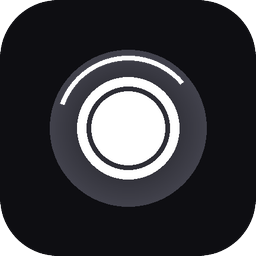
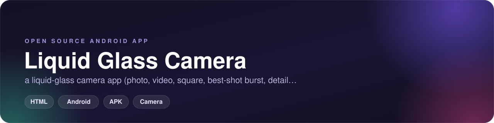

<div align="center">





<a href="https://github.com/technicalnihilist-lgtm/camera/stargazers"></a>&nbsp;<a href="https://github.com/technicalnihilist-lgtm/camera/network/members"></a>

<a href="https://github.com/technicalnihilist-lgtm/camera/releases/latest"></a>

<b>Support the work</b>

  

<sub>Donations aren't live yet — Paytm, UPI, PayPal and Buy&nbsp;Me&nbsp;a&nbsp;Coffee all show <b>coming soon</b>. Until then, a ⭐ star is the best support.</sub>

<a href="https://github.com/technicalnihilist-lgtm/camera/releases/latest"></a>  <a href="https://github.com/technicalnihilist-lgtm/camera/releases"></a>

</div>

---

## Download

**[⬇ Download the APK](../../releases/latest)** — `liquid-glass-camera.apk` (Android 7.0+, ~41 KB)

The web version is the same app in one file: open [`index.html`](index.html) in Chrome or Safari. It needs a secure origin (https, localhost, or the file opened directly) before the browser will give it a camera.

## What it does

- **Photo, Video, Square** modes, with a spring-animated mode indicator
- **4D tilt parallax** — every glass layer sits at its own depth and drifts against the preview as you tilt the phone, with the specular highlight sweeping across the glass as it moves; strength is adjustable
- **Depth effect** — background softening that applies to the live preview, the saved photo *and* the recorded video, with a strength slider
- **1× / 2× / 3× zoom** — hardware zoom where the camera exposes it, digital zoom otherwise
- **Best-shot burst** — takes several frames and keeps the sharpest one
- **Detail boost** — a small unsharp pass on the captured frame
- **Tap to focus & expose** — sends a focus point of interest to the camera where supported
- **Quality presets** — Max / High / Standard control the requested stream size, JPEG quality and video bitrate
- **Grid, 3s / 10s timer, torch**, front/back flip
- **Video recording** with audio, plus a live recording timer
- **Viewer** with previous/next, and **Save** to the gallery

The important detail: **what you see is what you get**. The preview is a centre crop of the camera frame, and every capture (photo *and* video) is cropped through the same maths, so the saved file matches the framing on screen — including zoom, the selfie mirror and the depth falloff.

## How the two effects work

**4D parallax.** Each chrome layer — top bar, zoom pill, mode switcher, controls, toast — carries a depth value from 18 down to 9, and the preview itself carries −7 so it drifts the other way. Motion comes from `deviceorientation` (the phone's gyro, with the tilt baseline taken from the first reading so a held phone sits neutral) and falls back to pointer movement on desktop. Values are smoothed with a frame-rate-independent lerp, so it settles rather than jitters, and the render loop stops when the movement stops. On iOS the orientation permission is requested on the first tap. With `prefers-reduced-motion` the effect starts off.

**Depth of field.** A capture is composited against a blurred copy of itself: the frame is downscaled to a fifth, blurred, masked with a feathered radial gradient that keeps the middle sharp and fades to full blur at the edges, then drawn back over the original. The preview shows the same falloff live through a masked `backdrop-filter`, so you see the look before you shoot. Video runs the same pass inside the recording canvas, which is why the saved clip matches the preview.

## Settings

Everything that shapes the look and the two effects lives in one sheet, behind the sliders button in the top bar:

- **Glass & motion** — transparency, bounce, water sound
- **4D & depth** — 4D tilt parallax on/off, **parallax strength** (0 – 1.7×), depth effect on/off, **depth strength** (0 – 100%)

Values are saved on the device and restored on the next launch, so the app opens the way you left it.

It is a **centre-weighted** depth effect, not subject detection — there is no ML segmentation in this build, so a subject that is not near the middle will get softened along with the background. Turn it off, or drop the strength, when that matters.

## How the APK works

There is no React Native or Flutter here, and no web-to-app build service. The APK is a small Android wrapper around the same HTML file:

| File | Role |
| --- | --- |
| `app/MainActivity.java` | WebView host, camera/mic permission bridge, gallery save, file picker |
| `app/AndroidManifest.xml` | Manifest: camera + mic permissions, portrait, fullscreen |
| `app/build.sh` | The whole build: javac → d8 → aapt2 → zipalign → apksigner |
| `index.html` | The app itself, inlined into the APK as `assets/index.html` |

Two details make it work rather than being a broken WebView shell:

1. **The page is served from `http://127.0.0.1`** by a ~120-line socket server inside the app, not loaded from `file://`. Loopback counts as a secure origin, so `getUserMedia` and `MediaRecorder` are allowed. A `file://` page would be refused the camera by Chromium.
2. **Saving is native.** WebView ignores `<a download>` for `blob:` URLs, so the page hands the bytes to the app in 3 MB chunks over a `@JavascriptInterface` bridge, and the app writes them into `Pictures/Liquid Glass Camera` or `Movies/Liquid Glass Camera` through MediaStore.

Permissions requested at runtime: **Camera** (always), **Microphone** (only when you record video with sound).

## Build it yourself

No Gradle. You need bash, curl and unzip; the script fetches the rest.

```bash
bash app/setup-toolchain.sh   # portable JDK 17 + build-tools 34 + platform 34
bash app/build.sh             # → out/liquid-glass-camera.apk
node tests/regress.js         # headless check of the shipped behaviour
```

Repository layout:

```
index.html                                  the app (inlined as assets/index.html)
app/AndroidManifest.xml                     permissions, versionCode/versionName
app/src/app/liquidglass/camera/MainActivity.java
app/res/mipmap-xxhdpi/ic_launcher.png
app/keystore.jks                            dev signing key, password "android"
app/build.sh · app/setup-toolchain.sh
tests/regress.js                            puppeteer checklist
```

The keystore is committed on purpose: it keeps the signature stable across builds so an updated APK installs over the previous one. It is a throwaway self-signed key — generate your own before publishing anywhere real.

## Notes

- Photo capture runs a burst on the main thread, so a shot takes a moment on slower phones — that is the burst, detail-boost and depth work, not a freeze.
- Video is recorded through a canvas pipeline, which is what bakes zoom, framing and depth into the file. Where the platform can't do MP4 it falls back to WebM.
- The APK is signed with a self-signed key, so Play Protect will ask before installing from a browser download — that is expected for sideloaded builds.

---

---

## 🌍 Languages

<sub>Donations are <b>coming soon</b> in every language below — nothing to pay today, nothing to click.</sub>

<div align="center">

<sub><b>हिन्दी · বাংলা · मराठी · తెలుగు · தமிழ் · ગુજરાતી · ಕನ್ನಡ · മലയാളം · ਪੰਜਾਬੀ · ଓଡ଼ିଆ · অসমীয়া · اردو</b></sub>

</div>

<details>
<summary><b>🌍 Open the same message in 53 languages</b></summary>

**🇮🇳 Indian languages**

- **हिन्दी** (Hindi) — ☕ जल्द ही आ रहा है। · ⭐ अगर आपको यह ऐप और हमारा काम पसंद है, तो कृपया रिपॉजिटरी को स्टार दें और हमें फॉलो करें।
- **বাংলা** (Bengali) — ☕ খুব শিগগিরই আসছে। · ⭐ যদি আপনার এই অ্যাপ এবং আমাদের কাজ ভালো লাগে, তবে অনুগ্রহ করে রিপোজিটরিটিকে একটি স্টার দিন এবং আমাদের ফলো করুন।
- **मराठी** (Marathi) — ☕ लवकरच येत आहे. · ⭐ जर तुम्हाला हे ॲप आणि आमचं काम आवडलं असेल, तर कृपया रिपॉझिटरीला स्टार द्या आणि आम्हाला फॉलो करा.
- **తెలుగు** (Telugu) — ☕ త్వరలో రాబోతోంది. · ⭐ మీకు ఈ యాప్, మా పని నచ్చితే, దయచేసి రిపోజిటరీకి ఒక స్టార్ ఇచ్చి మమ్మల్ని ఫాలో అవ్వండి.
- **தமிழ்** (Tamil) — ☕ விரைவில் வருகிறது. · ⭐ உங்களுக்கு இந்த ஆப்பும் எங்க வேலையும் பிடிச்சிருந்தா, தயவுசெஞ்சு இந்த ரெபாசிட்டரிக்கு ஒரு ஸ்டார்…
- **ગુજરાતી** (Gujarati) — ☕ ટૂંક સમયમાં આવી રહ્યું છે. · ⭐ જો તમને આ એપ અને અમારું કામ ગમતું હોય, તો પ્લીઝ રિપોઝિટરીને સ્ટાર આપો અને અમને ફોલો કરો.
- **ಕನ್ನಡ** (Kannada) — ☕ ಶೀಘ್ರದಲ್ಲೇ ಬರುತ್ತಿದೆ. · ⭐ ನಿಮಗೆ ಈ ಆ್ಯಪ್ ಮತ್ತು ನಮ್ಮ ಕೆಲಸ ಇಷ್ಟವಾದರೆ, ದಯವಿಟ್ಟು ರೆಪೊಸಿಟರಿಗೆ ಸ್ಟಾರ್ ಕೊಡಿ ಮತ್ತು ನಮ್ಮನ್ನು ಫಾಲೋ ಮಾಡಿ.
- **മലയാളം** (Malayalam) — ☕ ഉടൻ വരുന്നു. · ⭐ നിങ്ങൾക്ക് ഈ ആപ്പും ഞങ്ങളുടെ പ്രവർത്തനവും ഇഷ്ടപ്പെട്ടെങ്കിൽ, ദയവായി റെപ്പോസിറ്ററിക്ക് ഒരു സ്റ്റാർ…
- **ਪੰਜਾਬੀ** (Punjabi) — ☕ ਜਲਦੀ ਆ ਰਿਹਾ ਹੈ। · ⭐ ਜੇ ਤੁਹਾਨੂੰ ਇਹ ਐਪ ਅਤੇ ਸਾਡਾ ਕੰਮ ਪਸੰਦ ਹੈ, ਤਾਂ ਕਿਰਪਾ ਕਰਕੇ ਰਿਪੋਜ਼ਟਰੀ ਨੂੰ ਸਟਾਰ ਦਿਓ ਅਤੇ ਸਾਨੂੰ ਫਾਲੋ ਕਰੋ।
- **ଓଡ଼ିଆ** (Odia) — ☕ ଖୁବ୍ ଶୀଘ୍ର ଆସୁଛି। · ⭐ ଯଦି ଆପଣଙ୍କୁ ଏହି ଆପ୍ ଏବଂ ଆମର କାମ ଭଲ ଲାଗୁଛି, ତେବେ ଦୟାକରି ରିପୋଜିଟୋରୀକୁ ଗୋଟିଏ ଷ୍ଟାର୍ ଦିଅନ୍ତୁ ଏବଂ ଆମକୁ ଫଲୋ କରନ୍ତୁ।
- **অসমীয়া** (Assamese) — ☕ অতি সোনকালেই আহি আছে। · ⭐ যদি আপুনি এই এপটো আৰু আমাৰ কাম ভাল পায়, তেন্তে অনুগ্ৰহ কৰি ৰিপজিটৰীটোক এটা ষ্টাৰ দিয়ক আৰু আমাক ফ'ল' কৰক।
- **اردو** (Urdu) — ☕ جلد آرہا ہے۔ · ⭐ اگر آپ کو یہ ایپ اور ہمارا کام پسند آئے تو براہ کرم ریپازٹری کو سٹار دیں اور ہمیں فالو کریں۔
- **संस्कृतम्** (Sanskrit) — ☕ शीघ्रमेव आगच्छति।
- **मैथिली** (Maithili) — ☕ जल्दिये आबि रहल अछि।
- **कोंकणी** (Konkani) — ☕ रोखडेंच येता.
- **کٲشُر** (Kashmiri) — ☕ جَلدی یِوان چھُ۔
- **سنڌي** (Sindhi) — ☕ जल्द अची रह्यो आहे।
- **डोगरी** (Dogri) — ☕ जल्दी आ करदा ऐ।
- **ꯃꯤꯇꯩ ꯂꯣꯟ** (Manipuri) — ☕ ꯑꯊꯨꯕꯥ ꯃꯇꯝꯗꯥ ꯂꯥꯛꯀꯅꯤ꯫
- **बर’** (Bodo) — ☕ थाबैनो फैगोन।
- **ᱥᱟᱱᱛᱟᱲᱤ** (Santali) — ☕ ᱞᱚᱜᱚᱱ ᱦᱤᱡᱩᱜ ᱠᱟᱱᱟ᱾
- **नेपाली** (Nepali) — ☕ छिट्टै आउँदैछ। · ⭐ यदि तपाईंलाई यो एप र हाम्रो काम मन पर्‍यो भने, कृपया रिपोजिटरीलाई स्टार दिनुहोस् र हामीलाई फलो गर्नुहोस्।

**🌍 World languages**

- **العربية** (Arabic) — ☕ قريبًا. · ⭐ إذا أعجبك هذا التطبيق وعملنا، فيرجى منح المستودع نجمة ومتابعتنا.
- **简体中文** (Chinese (Simplified)) — ☕ 即将推出。
- **繁體中文** (Chinese (Traditional)) — ☕ 即將推出。
- **Čeština** (Czech) — ☕ Již brzy.
- **Dansk** (Danish) — ☕ Kommer snart.
- **Nederlands** (Dutch) — ☕ Binnenkort beschikbaar. · ⭐ Vind je deze app en ons werk leuk?
- **Filipino** (Filipino) — ☕ Malapit na.
- **Suomi** (Finnish) — ☕ Tulossa pian.
- **Français** (French) — ☕ Bientôt disponible. · ⭐ Si cette application et notre travail vous plaisent, mettez une étoile au dépôt et suivez-nous.
- **Deutsch** (German) — ☕ Bald verfügbar. · ⭐ Wenn dir diese App und unsere Arbeit gefallen, gib dem Repository einen Stern und folge uns.
- **Ελληνικά** (Greek) — ☕ Έρχεται σύντομα.
- **עברית** (Hebrew) — ☕ בקרוב.
- **Magyar** (Hungarian) — ☕ Hamarosan.
- **Bahasa Indonesia** (Indonesian) — ☕ Segera hadir. · ⭐ Jika kamu suka aplikasi ini dan karya kami, beri bintang pada repositori ini dan ikuti kami.
- **Italiano** (Italian) — ☕ In arrivo.
- **日本語** (Japanese) — ☕ 近日公開。 · ⭐ このアプリと私たちの仕事が気に入ったら、リポジトリにスターを付けてフォローしてください。
- **한국어** (Korean) — ☕ 곧 공개됩니다. · ⭐ 이 앱과 저희 작업이 마음에 드신다면 저장소에 스타를 눌러 주시고 팔로우해 주세요.
- **Bahasa Melayu** (Malay) — ☕ Akan datang.
- **Norsk** (Norwegian) — ☕ Kommer snart.
- **فارسی** (Persian) — ☕ به‌زودی.
- **Polski** (Polish) — ☕ Wkrótce. · ⭐ Jeśli podoba Ci się ta aplikacja i nasza praca, daj repozytorium gwiazdkę i obserwuj nas.
- **Português** (Portuguese) — ☕ Em breve.
- **Română** (Romanian) — ☕ În curând.
- **Русский** (Russian) — ☕ Скоро. · ⭐ Если вам нравится это приложение и наша работа, поставьте звёздочку репозиторию и подпишитесь на нас.
- **Español** (Spanish) — ☕ Muy pronto. · ⭐ Si te gusta esta app y nuestro trabajo, dale una estrella al repositorio y síguenos.
- **Kiswahili** (Swahili) — ☕ Inakuja hivi karibuni.
- **Svenska** (Swedish) — ☕ Kommer snart.
- **ไทย** (Thai) — ☕ เร็ว ๆ นี้
- **Türkçe** (Turkish) — ☕ Çok yakında.
- **Українська** (Ukrainian) — ☕ Незабаром.
- **Tiếng Việt** (Vietnamese) — ☕ Sắp ra mắt. · ⭐ Nếu bạn thích ứng dụng này và công việc của chúng tôi, hãy tặng kho lưu trữ một ngôi sao và theo…

</details>

